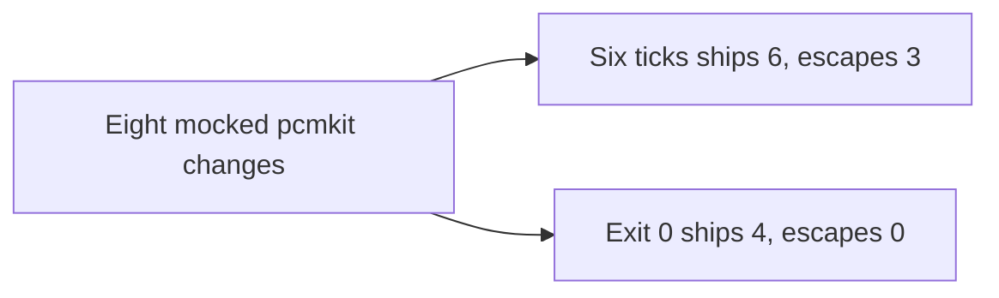

# Capstone. The same changes, before and after

The harness is a change to a decision. The way you know it changed the decision is to run the same changes through the old rule and the new rule and write down the difference. This page does that on `pcmkit`'s checks and on eight mocked rows. The rows are not a fleet of live agents. They are the before and after you can rerun with no API key.

The intuition is an A/B of two mix buses on the same stems. You do not compare Tuesday's band to Thursday's band and call it the compressor. You play the same take both ways.

## What "before" ships

Before, a change ships when a checklist has at least six ticks. That is the module 1 failure, scaled to eight rows in `tools/capstone/sessions.json`. Six of the eight have enough ticks. Three of those six have `check_exit` 1, so the before policy ships three red checks. It catches one red row, `p8`, only because that row has two ticks. Catch rate is 1/4. Two of the six ships were opened by a person, so reads per ship is 2/6. The cost of the shipped rows is 2.10. Holds are not in that cost. Module 12's week-long report includes them. This comparison is about what each policy ships.

## What "after" ships

After, a change ships when `check_exit` is 0. Four rows ship. None of them are red, so escapes are 0. All four red rows are held, so catch rate is 4/4. One shipped row was opened, so reads per ship is 1/4. Cost of the shipped rows is 0.80.

The drop in reads per ship is not the win by itself. The win is the three red ships that stopped, at the cost of also holding nothing that was green in this fixture. `p4` has only four ticks and a green check. Before, it does not ship. After, it does. A tick-count policy does not only ship junk. It also blocks finished work that did not fill the form.

```text
--8<-- "tools/capstone/expected.txt"
```

```python
--8<-- "tools/capstone/before_after.py"
```



## Where the real repository is

The checks those exit codes stand in for are the ones `make check` runs on this repo: `pcmkit` tests, the oracle, the mutant smoke, the end-to-end golden, sanitizers, and the harness tests, plus the held-out runner, the reviewer, the orchestrator, and this report. The heavy job adds Miri, a cargo-mutants smoke of `clamp.rs`, a short cargo-fuzz smoke of the WAV parser, and one Kani harness. The capstone script does not re-run that stack for each row. The rows carry an exit code the way a CI status would. Swapping in a live status is a one-line change to the fixture, and CI will then demand a new `expected.txt`. That is the ratchet from module 12 applied to the capstone itself.

The orchestrator in module 11 is the parallel half: six worktrees, three queued, stale reviews refused. The capstone does not pretend those six git worktrees are the eight policy rows. They answer different questions. The worktrees answer "did we review this tree." The policy answers "does a tick count ship a red check."

## What this page is not

It is not a measurement of Fable, Codex, or Cursor. No model was called. It is not a GitHub merge-queue result. It is not a production escape rate. The 3.70 and the 2/9 from module 12 are a different fixture, a recorded week, and they do not have to match 2.10 and 2/6. Different denominator, different question. Quote the file you ran.

## Where the tools differ

!!! note "Codex and Cursor"

    Give either tool `python3 tools/capstone/before_after.py` and ask for the ten lines, copied. A paragraph that says "the harness reduced escapes" without those lines is the tick-count policy in prose. The lines are the result. If you later point a cloud agent at `pcmkit`, keep this script as the before/after template and replace the fixture with status checks you actually downloaded. Do not replace it with the agent's summary of how the session felt.

## Try this

Someone averages the module 12 escape count with this page's `before_escapes 3` and calls it the course's escape rate.

??? success "What is wrong with the average?"

    They are different sets of rows. Module 12 has twelve recorded merges and two escapes. This page has eight policy rows and three red ships under the tick rule. An average is a third number nobody measured. Quote each file.

Next: the [lab](lab.md), the [quiz](quiz.md), and the [project](project.md).
