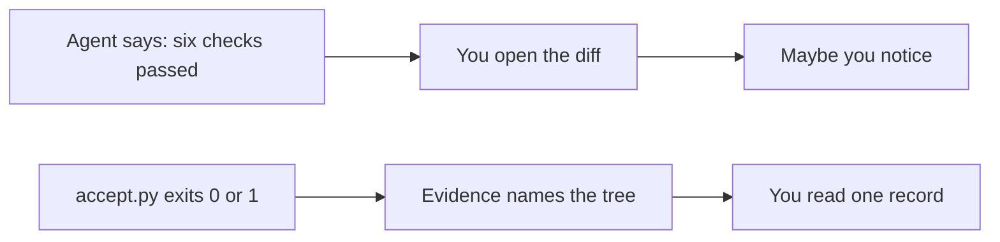

# 1. Why verification beats review

A coding agent will hand you a pull request that looks finished. The summary is specific. The checklist is ticked. The tests it wrote are the tests it passed. None of that is a measurement of the tree. A measurement is a command you did not let the agent rewrite, run on the tree you are about to merge, with an exit code you stored.

That is the whole module. The rest is what happens to your afternoon if you forget it, and what you still have to read yourself.

## The picture

You asked for `pcmx gain --normalize` to bring a clip to a peak of 1 and to leave digital silence alone. The agent replies with six ticks: format, clippy, unit tests, a golden file, a screenshot of a waveform, and "listened in my head." You open the diff and the function returns the buffer unchanged when every sample is zero, which is right, and it also returns the buffer unchanged when the peak is 0.4, which is the bug. The ticks are about a different question. They ask "did the agent feel done?" The command asks "is the peak 1?"

The left path scales with how many agents you started. The right path scales with how many commands you trusted. Anthropic's review note is the public version of the same shift: pull-request volume doubled while the share of changes that were reverted fell by more than 40 percent, in a codebase where Claude writes and reviews most of the changes ([code review at Anthropic](https://claude.dev/blog/solving-code-review-at-anthropic/)). The article this course starts from tells a smaller story, six green ticks and a login that breaks on the second try. The story is useful. The salary in the headline is not a measurement, and the "last month, thirty Fable 5.2 agents" timeline does not fit the 9 November 2026 announcement. Both are on the [claim check](../claims.md).

## Throughput, written out

Suppose a diff takes ten minutes to read properly, and you will actually read for two hours before you start waving things through. That is twelve reviews. If you spend those two hours reading evidence instead, and a record takes two minutes when the commands already ran, you can look at sixty. The ratio is not magic. It is 10 divided by 2. It collapses the moment the "evidence" is a paragraph the agent wrote, because then you are reading prose again, and you are back to twelve.

Karpathy's line worth keeping is the one in [Verifiability](https://karpathy.bearblog.dev/verifiability/): software of this kind automates what you can verify. The February 2026 remark that agents "basically didn't work before December and basically work since" is a different sentence, recorded by [Simon Willison](https://simonwillison.net/2026/feb/26/andrej-karpathy/). Use the first when you decide what to hand an agent. Use the second as history, not as a spec.

## What you still read

Verification does not mean you stop looking. It means you look where a command cannot.

- A delete of user data, a payment, an auth change. The command can show that the tests you have still pass. It cannot show that you wanted the behaviour.
- A product decision hiding in a default. Normalize-to-peak is a product decision. A test can lock it once you have written the decision down. Module 2 is that write-up.
- The first time a new class of bug escapes. The escape becomes a check. Until it does, a person is the check.

"Reads per ship" is the count of that attention. Of the changes you merged, what fraction did a person open? In the lab fixture, six of the ten records have a passing check, and two of those six were opened. The ratio is 0.333. The two failures that were fully ticked and still opened are not in the denominator, because you did not ship them once you looked at the exit code. A ratio of zero on a payments diff is not a success. It is a gap in the policy.

## Where the tools differ

!!! note "Codex and Cursor"

    Claude Code will read `CLAUDE.md` and can run a Stop hook, so it is the tool this course hooks. Codex reads `AGENTS.md`, from the repo root down toward the working directory, and stops at 32 KiB by default ([Codex and AGENTS.md](https://developers.openai.com/codex/guides/agents-md), [agents.md](https://agents.md/)). Cursor reads project rules under `.cursor/rules/` ([rules](https://cursor.com/docs/context/rules)). Neither of those files can block a merge. The same sentence is copied into all three so the tools agree, and CI is what enforces it. The sentence is: done is a claim that a command exited 0 on this tree.

## Try this before the lab

You have a pull request. The author is an agent. The body says the normalize command was tested.

??? success "What would you need to see before you merge?"

    The command, the exit code, and a hash of the tree the command ran on. A sentence that says "tested" is the claim. The exit code is the result. If the hash is missing, a later edit can hide under an old pass. Module 4 binds the hash. This module only asks you to refuse the sentence.

Next: the [lab](lab.md), the [quiz](quiz.md), and the [project](project.md).
