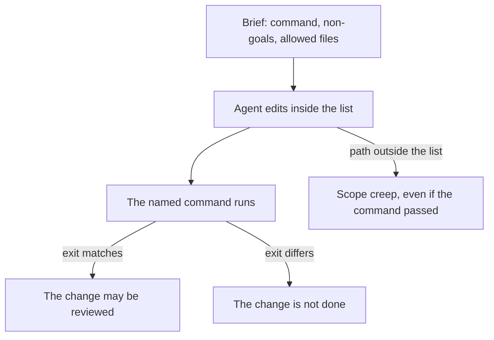

# 2. Defining done

An agent is a machine that fills in whatever you left blank. If the blank is "make the audio louder", it will pick a meaning, write tests for that meaning, and pass them. You will then be reviewing a solution to a problem you did not set. A brief is the problem, written so a program can reject a solution that answers a different one.

The intuition is the same one you already use for a DSP ticket. "Fix the click" is not a ticket. "A 1 kHz sine at -6 dBFS, 48 kHz, stays within one sample of the reference after a gain of +3 dB, and a buffer of zeros stays a buffer of zeros" is a ticket. The agent does not get a softer version because it is an agent.

## What a brief has to contain

Four sections, and a title line.

- **Goal.** The behaviour, including the case that should not change. Silence is the case people forget, and it is the case that turns a naive peak-normalize into a division by zero.
- **Acceptance.** A command and the exit status you require. "We will know when we hear it" cannot fail in CI.
- **Non-goals.** The neighbouring features the agent will invent if you do not forbid them. Sample-rate conversion is a different brief. Loudness in LUFS is a different brief.
- **Allowed files.** The paths this change may touch. A drive-by edit to the WAV writer can be correct and still be scope creep. The article's table names a file list for this and never implements one. The gate in module 4 reads this section.



The normalize brief in this repo is the example. The acceptance command builds a quiet WAV, runs `pcmx gain --normalize`, and checks the peak. It also builds a silent file and checks that the peak is still exactly zero. Both are in the goal, so both are in the command.

```markdown
--8<-- "briefs/gain-normalize/BRIEF.md"
```

## Why non-goals are part of done

A non-goal is not politeness. It is a test you are refusing to let the agent satisfy by changing the question. "Also resample to 48 kHz while you are in there" can make a demo sound better and still break a caller that was told the rate would be preserved. The allowed-file list is the mechanical half of the same idea. If resampling needs `wav.rs` and the brief does not list `wav.rs`, the diff is the signal.

Allowed files are globs relative to the repo root. The lint rejects an empty list. A missing brief does not mean "everything is allowed and we passed." In the gate, a missing active brief means the scope check is not in force, and the evidence says so. Those are different sentences. Module 4 keeps them different.

## Write the command before the implementation

The acceptance file exists so the brief's `command:` line points at something real. The lint checks that a token with a slash, or a token ending in `.py` or `.sh`, exists in the tree. That will not save you from a command that tests the wrong thing. It will save you from a command that is a sentence.

Read `briefs/gain-normalize/accept.py` before you trust it. It writes 16-bit WAVs with the standard library, runs `pcmx`, and checks a peak interval. It is not the differential oracle in `pcmkit/oracle/`. The oracle compares sample codes. The acceptance test checks the product behaviour the brief named. You want both, and you do not want to pretend they are the same check.

## Where the tools differ

!!! note "Codex and Cursor"

    A brief is an ordinary Markdown file. Claude, Codex, and Cursor can all read it if you point them at the path. None of them will refuse a vague brief on their own. The lint in this module is the refusal, and CI runs it. Codex's instruction file is still `AGENTS.md`, size-capped as in [the Codex guide](https://developers.openai.com/codex/guides/agents-md). Cursor's is still a rule under `.cursor/rules/` ([docs](https://cursor.com/docs/context/rules)). Put "read the active brief and stay inside Allowed-files" in all three. The check that the diff obeyed is the scope gate, not the instruction.

## Try this

Someone writes a brief whose acceptance section is "play the file and see if the click is gone."

??? success "What does the lint say, and what would you write instead?"

    The lint asks for a `command:` line and an `expect_exit:` line. "Play the file" is neither. A replacement names a command that builds a buffer with a known click, runs the repair, and exits 0 only when the click sample is inside the bound you wrote down. Listening can still be the `Exemption-reason` on a particular commit. It is not the acceptance command, because CI cannot hear.

Next: the [lab](lab.md), the [quiz](quiz.md), and the [project](project.md).
