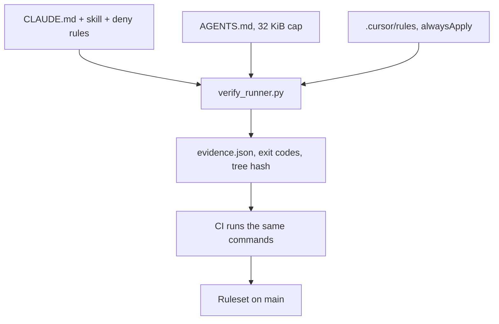

# 3. Instructions, permissions, and skills

An instruction file is a promise the tool can see. A permission is a door the tool is not supposed to open. A skill is a short procedure with a name. A hook, in the next module, is the thing that can still say no after the model has decided to stop. Mixing those four up is how a harness becomes a paragraph.

The intuition: you would not put "please do not edit the test runner" in a comment and then chmod the runner world-writable. The comment is still worth having, because the model reads it. The permission is what you want when the model is having a bad minute. Neither one is the lock on `main`. CI is.

## One sentence, three files

Claude Code reads `CLAUDE.md` ([memory](https://code.claude.com/docs/en/memory)). Codex reads `AGENTS.md`, walking from the repository root toward the current directory, appending as it goes, and stopping at `project_doc_max_bytes` which defaults to 32 KiB ([guide](https://developers.openai.com/codex/guides/agents-md)). A nested `AGENTS.md` closer to the work is appended later, so it wins on conflict. Cursor reads `.cursor/rules/*.mdc` when the rule says `alwaysApply: true` ([rules](https://cursor.com/docs/context/rules)).

If those three files disagree, you have three agents. The audit in this module requires the same sentence in all of them, and in `REVIEW.md`:

> Done is a claim: a command exited 0 on this tree.

`REVIEW.md` is the file Claude Code's review feature reads from the base branch, and only if branch protection is on so the pull request cannot replace it ([customize code review](https://code.claude.com/docs/en/code-review-customize)). A review guide that the diff can edit is a suggestion from the author of the diff.

```markdown
--8<-- "harness/CLAUDE.md"
```

The Codex copy stays short on purpose. A 40 KiB `AGENTS.md` looks thorough and then gets cut, and the cut is silent. The audit fails the file, and fails the concatenated walk, at 32 KiB.

## Permissions are not the same as instructions

Claude Code's deny rules live in `.claude/settings.json` ([permissions](https://code.claude.com/docs/en/permissions), [settings](https://code.claude.com/docs/en/settings)). The template denies edits under `.claude/` and `.verify/`, denies edits to the instruction files, and denies reading `.env` and the gate file. A deny rule is a client control. It is not a git hook, and it is not a ruleset. It is still worth setting, because the common failure is the agent editing the harness with the Edit tool to make a later command quieter.

```json
--8<-- "harness/.claude/settings.json"
```

`onFailure: block` is set on the hooks so a crash denies the action. A hook that fails open turns a bug in the gate into a pass. The settings file itself is on the locked-path list inside the runner, not only in this JSON. Deleting the deny rule from a worktree copy does not unlock the path. Module 4 is why.

## A skill that runs a command

Claude Code ships a bundled `/verify`. A repository skill at `.claude/skills/verify/SKILL.md` replaces it ([skills](https://code.claude.com/docs/en/skills)). Replacement is the detail the article leaves out. If you write a skill with that name, you have taken over the built-in one, so the skill has to be stricter than the built-in, not a thinner wrapper around "write a summary."

```markdown
--8<-- "harness/.claude/skills/verify/SKILL.md"
```

Codex and Cursor do not load that skill. The same command is written into `AGENTS.md` and the Cursor rule. CI runs the command with no skill and no model. That is the order of trust: the skill reminds Claude, the instruction files remind the other two, the runner produces the exit code, CI runs the runner on the merge.



## What you do not put in the instruction file

Do not put a secret in `CLAUDE.md`. Do not put a procedure so long that Codex truncates the only rule that mattered. Do not tell the agent to write `VERDICT: PASS`. Do not describe a local hook as if it were branch protection. The template says the opposite, in all three places, because a single confident file is how the wrong design spreads.

## Where the tools differ

!!! note "Codex and Cursor"

    Codex has no Claude hook and no `.claude/settings.json`. Its instruction surface is `AGENTS.md`, and it has a real "Code Review Rules" section, which the template fills with "quote the command and the exit code." Cursor's surface is the rule file, and `alwaysApply: true` is what makes it show up without someone remembering to attach it. Bugbot and cloud agents are separate products ([Bugbot](https://cursor.com/docs/bugbot), [cloud agents](https://cursor.com/docs/cloud-agent)). They are not this module. This module is the files a local session reads before it edits.

## Try this

You add a fourth rule only to `CLAUDE.md`: "never touch `wav.rs` during a normalize brief." Codex then edits `wav.rs`.

??? success "What failed?"

    The agreement was not copied. The audit looks for one shared sentence, not for every rule. A rule that matters has to be in `AGENTS.md` and the Cursor rule as well, or it has to be a check. "Do not touch `wav.rs`" is already the allowed-file list if the brief omitted it. Prefer the check. The sentence in the instruction file is the reminder.

Next: the [lab](lab.md), the [quiz](quiz.md), and the [project](project.md).
