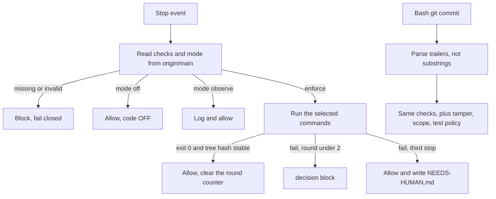

# 4. Hooks and gates

A hook is a program Claude Code runs when something happens. The Stop hook runs when the model wants to end the turn. The PreToolUse hook runs before a tool call, and a matcher can limit it to Bash. The gate is the decision inside that program: let the turn end, or hand the model another chance with a reason.

The intuition is a studio door. The sign on the door ("do not leave while the meters are red") is module 3. The door that actually stays shut is a hook that has looked at the meters. A sign the artist can rewrite, and a door whose lock is a note the artist wrote saying the meters were fine, is the design this module throws out.

## What Claude Code actually sends

On Stop, the process's stdin is a JSON object. The fields this course relies on are `session_id`, `cwd`, `hook_event_name`, `stop_hook_active`, and `last_assistant_message`. `stop_hook_active` is true when this stop is already the result of an earlier stop hook. Background tasks are recorded and ignored for the decision. They are not a way to skip the check. The documented way to keep the model working is exit 0 and a JSON object `{"decision":"block","reason":"..."}`. Empty stdout with exit 0 allows the stop. Exit 2 also blocks, and the docs treat the JSON decision as the path to use ([hooks](https://code.claude.com/docs/en/hooks)).

There is a platform cap. After eight consecutive continuations with no tool call, Claude Code stops honouring the block. The counter resets when the model uses a tool, so a dummy tool call is a way through a naive counter. The gate in this repo counts rounds itself, outside the repository, and when the count would pass the cap it stops blocking and records `PLATFORM_CAP` instead of pretending the platform will keep looping.

On PreToolUse for Bash, stdin includes `tool_name` and `tool_input.command`. A deny is exit 0 and `hookSpecificOutput` with `hookEventName` set to `PreToolUse`, `permissionDecision` set to `deny`, and a reason. Unknown JSON keys can fail validation and fail open, so the hook prints only the documented fields. `onFailure: block` in settings means a crash denies rather than allows.

The recorded shapes live in `scenarios/events/`. CI replays them. No model is called.

```json
--8<-- "scenarios/events/stop.json"
```

## The ten holes, and the patch

The article's sketches are a useful list of mistakes. Each one is a scenario the corpus runs. The corrected behaviour is what `harness/` does.

1. **Self-attested evidence.** Grepping `VERDICT: PASS` in a file the agent writes is the starter in the lab. The runner executes the commands in `checks.json` and writes `evidence.json`. The agent may add notes after that. CI can recompute the record. A forged verdict fails the integrity hash.
2. **Freshness by mtime.** `touch` updates a timestamp and does not update a hash of the file contents. The tree hash is sha256 of the sorted paths and their bytes, excluding `.git`, build directories, and the evidence files the runner is about to write. If a check itself edits the tree, the verdict is fail.
3. **The agent turns the gate off.** The mode, the checks, and the active brief are read with `git show` from the base ref. The base ref is `VERIFY_BASE_REF`, else `origin/main`, else `main`. A dirty `.verify/gate.json` in the worktree is not the mode. It is also a locked path, so the diff is blocked. The minimum locked set is in the runner's source, so deleting the list from JSON does not unlock `.claude/settings.json`.
4. **Self-exemption.** The letters `Verified-by: none` in the middle of a command are not an exemption. A parsed trailer is. It needs `Exemption-reason` of at least 20 characters that is not a placeholder (`later`, `n/a`, `ship it`). The two trailers have to sit in the same trailer paragraph. An exemption allows the local commit and does not skip locked paths, the tamper scan, scope, or a test edit. CI still runs the checks.
5. **Tests.** Adding a test is free. Modifying or deleting a test path needs a `Test-change-approved` trailer with a real reason. Adding `#[ignore]` or `pytest.skip` is still denied. The patterns are in `checks.json`.
6. **Fail open.** A base ref with no checks file, or with invalid JSON, blocks. The trigger script exits non-zero. It does not "trigger nothing" and return success. `origin/main` wins over a local `main` that has drifted.
7. **Local hooks are not the lock.** The hook sees Claude's Bash tool. It does not see a person, Codex, or `git commit-tree`. The commit detector ignores `commit-tree` and fails closed on a command substitution that hides the word `commit` (`git $(echo commit)`). The lock you can believe is the workflow, the ruleset, and CODEOWNERS. The ruleset template is in the repo. GitHub does not enforce it until you apply it in the repository settings.
8. **The counter.** Rounds live under `$VERIFY_STATE_DIR` or `/tmp/verify-course/<repo>/<session>.json`, not in `.verify/.tries`. Two blocks, and the third stop is allowed to end. The runner writes `.verify/NEEDS-HUMAN.md`. That is an escalation. A file full of tries left in the repo by another session does not move this session's count. `stop_hook_active` is included in the reason and does not reset the count.
9. **Scope.** If the base ref has `.verify/active-brief` pointing at a brief, changed paths have to match Allowed-files. No pointer means scope is off, and the evidence says it was not checked. An empty diff can pass, and it says the diff was empty.
10. **A property that cannot fail.** "Balance stays non-negative" with only deposits is the weak lab. The strong one deposits, withdraws, and rejects an overdraft. The buggy ledger ignores withdrawals and the strong check fails it.



The hook scripts are thin. They parse stdin, call the engine, and always exit 0 so a decision is a decision and not a crash.

```python
--8<-- "harness/.claude/hooks/stop_gate.py"
```

```python
--8<-- "harness/.claude/hooks/commit_gate.py"
```

The mode file on the base ref:

```json
--8<-- "harness/.verify/gate.json"
```

`observe` logs and allows, and it still increments the round counter so a later switch to `enforce` is not the first time you discover the loop. `off` on the base ref returns before the checks run. `off` only in the worktree does not.

## The corpus is the lesson

`python3 tools/mockagent/replay.py` builds a throwaway git repository, copies the harness in, and feeds the hooks. The passing profile has a check that exits 0. The failing profile exits 1. Other profiles drop the checks file from the base commit, point `origin/main` at a stricter command than local `main`, or set an active brief. Thirty scenarios have to pass, including a handwritten PASS that is ignored, a substring exemption that is denied, a trailer with a real reason that is allowed locally, a skip marker that an owner trailer does not excuse, a test-name special case, an `__eq__` that returns true, a call counter, and a third stop that escalates.

That corpus is a catch rate on a toy set. It is the right shape of evidence. It is not a proof that the next cheat will fail. When one gets through, it becomes scenario thirty-one.

## Where the tools differ

!!! note "Codex and Cursor"

    These hooks are Claude Code events ([hooks](https://code.claude.com/docs/en/hooks)). Codex does not run `.claude/hooks/stop_gate.py` when it finishes a turn. Cursor does not either. Both can still be told, in `AGENTS.md` and `.cursor/rules/verification.mdc`, to run `python3 .verify/verify_runner.py` and to treat a non-zero exit as not done. The program that blocks a merge is the workflow, which runs the same engine without a hook. If you only install the hook, you have guarded one tool's Bash `git commit` and left the branch open.

## Try this

The model writes `VERDICT: PASS` into `evidence.md` and runs `touch` on it.

??? success "What does the corrected stop hook do?"

    It ignores the file as a verdict. It runs the commands from the base ref and hashes the tree. A touched timestamp is not in that hash. If the commands fail, the hook returns `decision: block` until the round limit, then escalates. The starter in the lab allows the touch. That contrast is the exercise.

Next: the [lab](lab.md), the [quiz](quiz.md), and the [project](project.md).
