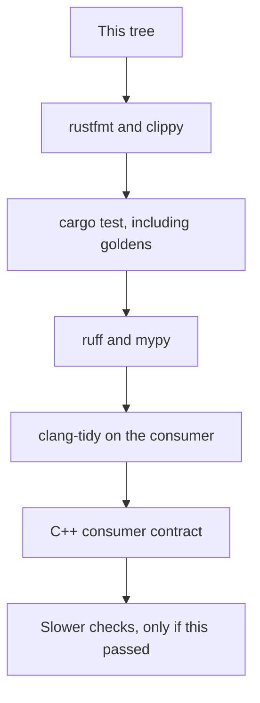

# 5. Fast deterministic layers

A check you will not wait for is a check you will turn off. The fast tier is the stack that answers, on this tree, before you have lost the thread: format, lint, types, unit tests, a byte-for-byte golden, and the C++ caller. It is deterministic. The same tree produces the same bytes. Nothing in it sleeps, skips, or retries until the clock is kinder.

The intuition is a soundcheck. You do not book the hall and then discover the cable is in the wrong jack. You plug in, you look at the meter, you move on. The hall is module 8. This module is the meter.

## What "fast" means here

`make fast` runs, in order:

- `cargo fmt --check` and `cargo clippy -D warnings`
- `cargo test` for the workspace, which includes the golden bytes, the fixed-seed properties, the parser smoke, and the exhaustive gain grid from later modules
- a scan that rejects sleeps, skips, and a retry loop
- `ruff` and `mypy` on `pcmkit/fast`, `pcmkit/e2e`, and `pcmkit/oracle` (`ruff==0.17.6`, `mypy==2.4.1`)
- `clang-tidy` 18 on the C++ consumer, with the check set in `pcmkit/cpp/run_tidy.sh`
- the C++ consumer, which is the contract test for the C ABI

On a warm build that stack is seconds, not a minute. CI runs it inside `make check` and does not fail the job on a stopwatch. A cold Actions runner spends time on apt and on the first compile. That time is not a property of the tests, so the course does not pretend a 60-second assertion would be measuring the suite. The budget is a design rule: if a check in this tier starts taking a coffee break, it does not belong here.



## Goldens are bytes

A golden file is a committed output. The test re-encodes a fixed buffer and compares every byte. Same length is not the same file. Two clips can share a size and disagree about a sample.

`UPDATE_GOLDEN=1` rewrites `pcmkit/golden/tone_i16.wav` and `tone.png`. That flag is for a human who is about to read the diff. An agent that sets it to make the test pass has replaced the contract with the implementation. Review the diff or do not take the update.

[insta](https://insta.rs/docs/) is the usual Rust tool for this, and [cargo-nextest](https://nexte.st/) is the usual faster runner. This repository does not install either. The golden test in `course_checks.rs` is the thing CI runs. A snippet of an insta assertion that never executes would be a claim.

## The ABI is a contract, not a print

The C++ consumer calls `pcmkit_apply_gain`, `pcmkit_normalize`, and `pcmkit_peak`. It checks a +60 dB clamp, a null pointer, a NaN gain that must leave the buffer untouched, a NaN sample that must not be half-applied, silence, and a normalize to peak 1. "It printed ok" is the last line. The checks above it are the contract. A Rust test that never crosses the ABI can stay green while the header and the library disagree. The consumer is how you notice.

## Flakes are a policy, not a mood

The [verification note](https://claude.dev/blog/how-the-claude-code-team-thinks-about-verification/) is plain about flakes: no skip, no sleep, no retry-until-green. Delete the test and write down why. `pcmkit/fast/flaky_scan.py` enforces the mechanical half on `pcmkit/` and `briefs/`. It looks for the call. A sentence in a lesson that names the policy is not a hit. A test that calls `time.sleep` is.

```python
--8<-- "pcmkit/fast/flaky_scan.py"
```

## Where the tools differ

!!! note "Codex and Cursor"

    The fast tier is a command, `make fast`. Codex reads it from `AGENTS.md` if you put it there, and Cursor from a project rule ([Codex](https://developers.openai.com/codex/guides/agents-md), [Cursor rules](https://cursor.com/docs/context/rules)). Neither tool grows a Stop hook. The workflow runs the command anyway. Keep the instruction short. The 32 KiB cap is a reason to name `make fast` and not paste the clippy output you once liked.

## Try this

A golden test fails. The agent updates the golden and says the suite is green.

??? success "What do you look at before you accept the update?"

    The diff of the bytes. A one-sample change in a tone you meant to retune is a review. A change in a header size, or a PNG that no longer matches the waveform you committed, is a behavior change wearing a test update. `UPDATE_GOLDEN=1` is not evidence. The diff is the thing you accept or refuse.

Next: the [lab](lab.md), the [quiz](quiz.md), and the [project](project.md).
