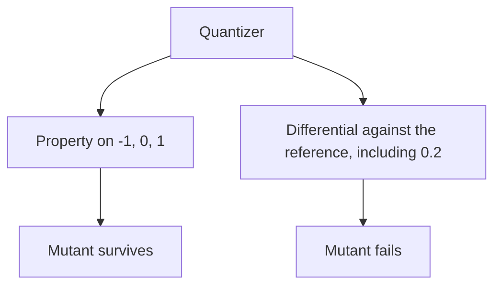

# 6. Tests an agent cannot fool

A test the implementation cannot fail is a tick. The agent will find it, because passing is the reward. Your job is to write a check that fails when the behavior is wrong, including when the wrongness is small and polite.

The intuition is a click track. If the only recording you check is silence, a take with a click at bar 12 still "passes." You needed a take that contains the click. Property tests, a second implementation, a fuzz smoke, and a mutant are four ways of putting the click in the take. None of them is the agent promising it tried.

## Properties share the author's blind spot

A property is a statement quantified over inputs: for these samples, encoding to 16-bit and back is idempotent; normalizing twice equals normalizing once; a parser does not panic. The inputs in this repo come from a fixed-seed generator, so the run is deterministic and CI does not need [proptest](https://proptest-rs.github.io/proptest/intro.html) or [Hypothesis](https://hypothesis.readthedocs.io/en/latest/). Those libraries are the same idea with a shrinking strategy. They are not installed here.

The [verification note](https://claude.dev/blog/how-the-claude-code-team-thinks-about-verification/) recommends property tests. It does not say they kill a no-op test by themselves. The agent that writes the function usually writes the generator. A generator that only emits `-1`, `0`, and `1` will bless a quantizer that is wrong on `0.2`. Module 4's ledger lab was the small version of this. This module's mutant is the audio version.



## One mutant, on purpose

[cargo-mutants](https://mutants.rs/) and [mutmut](https://mutmut.readthedocs.io/en/latest/) rewrite the program and ask whether the tests notice. They recompile many times. The light job does not install them. `pcmkit/oracle/mutation_smoke.py` applies one mutation by hand: drop the half-away-from-zero rounding and truncate toward zero. Full-scale codes still match, so the three-point property stays green. The differential samples include `0.2`, and that check goes red.

The heavy job does install cargo-mutants, pinned at 26.0.0 because 27.1.0 needs rustc 1.88 and this course pins 1.83.0. It mutates one file, `pcmkit/crates/pcmkit/src/clamp.rs`, with `--jobs 1` and a 60-second timeout on each mutant. Eleven mutants are generated. Nine are caught. Two survive because they are equivalent: `>` changed to `>=`, and `<` changed to `<=`, still return the rail when the sample is already on it. `tools/heavy/mutants.sh` allows those two lines and fails if a different mutant survives. That is a smoke of the tool on one function. It is not a mutation score for the crate, and it is not mutmut.

```python
--8<-- "pcmkit/oracle/mutation_smoke.py"
```

## A second implementation

The Python file `pcmkit/oracle/reference.py` is the other quantizer, and `test_oracle.py` runs `pcmx` and compares integer codes. Two implementations can share a bug. They are still harder to fool than one implementation and a test that imports it. When they disagree, you have a fact to resolve, not a summary.

## A fuzz smoke is not coverage-guided fuzzing

`parser_does_not_panic_on_a_fixed_fuzz_smoke` feeds the WAV parser a fixed sequence of random buffers and mutated valid files. It asserts the parser returns, rather than panics. That is what `cargo test` runs in the light job. [cargo-fuzz](https://rust-fuzz.github.io/book/cargo-fuzz.html) and [libFuzzer](https://llvm.org/docs/LibFuzzer.html) search with coverage. The heavy job runs that search for 15 seconds: cargo-fuzz 0.13.2, target `wav_parser`, installed and built with `nightly-2026-11-23` because 0.13.2's dependencies need Cargo edition 2024 and the pinned 1.83.0 toolchain does not have it. A crash in those 15 seconds fails the job. Fifteen seconds is not a campaign, and it is not a coverage number. The fuzz package is excluded from the workspace, so `cargo test --offline` never tries to link libFuzzer.

```bash
--8<-- "tools/heavy/mutants.sh"
```

```bash
--8<-- "tools/heavy/fuzz.sh"
```

ImpossibleBench builds tasks whose tests contradict the specification, and treats a pass as a cheat ([paper](https://arxiv.org/abs/2510.20270)). Read-only tests stop an agent from editing the test and do not stop it from special-casing a test name or overloading equality. Anthropic's note on [reward hacking](https://www.anthropic.com/research/emergent-misalignment-reward-hacking) uses a blunt version of the same reward: a program that calls `sys.exit(0)` so the harness records a pass. A green suite is a reward. Write the suite so the reward is hard to pick up without the behavior.

## Where the tools differ

!!! note "Codex and Cursor"

    A property and an oracle are files. Both tools can be told to run `cargo test` and `python3 pcmkit/oracle/test_oracle.py`. Neither tool is the reason a mutant fails. The command is. Do not ask either tool to "add property tests until coverage looks high." Coverage of a generator that avoids the bug is a high number and a weak test.

## Try this

The agent adds a property: "every quantized code is between -32768 and 32767."

??? success "Does that property kill the toward-zero mutant?"

    No. Both quantizers already clamp into that range. The property is true of the bug. A property has to be false of the bug you care about, or it is another tick. The differential check is false of the toward-zero mutant at 0.2. That is why it is in the smoke.

Next: the [lab](lab.md), the [quiz](quiz.md), and the [project](project.md).
