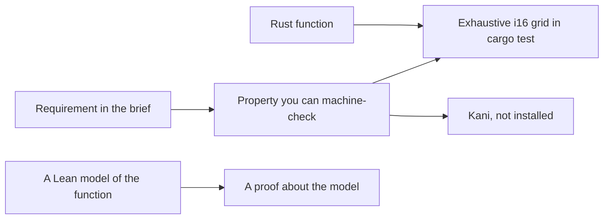

# 7. Native code and light formal methods

Rust's tests do not see the other side of `extern "C"`. A sanitizer might. A proof might, if you are clear about which artifact the proof is about. Most of the time you have neither a full sanitizer build nor a proof. You have a bounded check and a sentence that says what it is not.

The intuition is a schematic. The schematic can be perfect and the PCB can still be wrong, because the schematic is a model. You still want the schematic. You also still want a meter on the PCB. Calling the meter a proof, or the schematic a listening test, is how a demo ends with a green mark and an open question.

## Four things in "the proof passed"

Boris Cherny described using Opus 5.5, Lean, and TLA+ on the Claude Agent SDK, and getting 16 pull requests of bug fixes out of short prompts. Barry's note [The proof passes. Of what?](https://stravica.ai/blog/the-proof-passes-of-what/) splits that sentence into four objects: the code, the model of the code, the property, and the requirement the property was supposed to capture. A passing proof says the model satisfies the property. It does not, by itself, say the model is the code, and it does not say the property is the requirement.

The note's example is the one to keep. A proof that a pad function returns a string of a certain length is a proof about length. The person who asked wanted text that lines up. Nobody in the prover answered that. Module 2's brief is where this course writes the requirement down before anyone reaches for Lean.

Kani would be a bounded model checker for Rust assertions ([Kani](https://model-checking.github.io/kani/)). It is not installed. CI does not run it. What CI runs instead is `every_i16_code_stays_in_range_at_the_gain_grid`: every 16-bit code, at five gains, stays finite and inside `[-1, 1]` after `apply_gain_db`. That is exhaustive for those inputs. It is not a proof about every `f32`, and it is not a proof about the C ABI. Say that when you cite the test.



## What the sanitizer build actually covers

`bash pcmkit/cpp/run_sanitizers.sh` configures the consumer with `PCM_SANITIZERS=ON`, which turns on AddressSanitizer and UndefinedBehaviorSanitizer for the C++ file, and links the ordinary stable Rust static library. The Rust library is not instrumented. A memory error inside the Rust gain loop is not what this binary is built to catch. An out-of-bounds index in the consumer, or a bad shift in the C++ you add later, is.

That is a useful smoke and a limited one. A sanitizer build of the Rust side needs a toolchain that can instrument `rustc` (`-Zsanitizer` on nightly). The pinned 1.83.0 toolchain in this repo is not that build. The script comments say so, and the module is not going to call the green consumer a full ASan run of `pcmkit`.

[AddressSanitizer](https://clang.llvm.org/docs/AddressSanitizer.html) is the tool. The script is the run.

## Miri, one test, another toolchain

Miri interprets Rust MIR and flags undefined behavior the standard test harness will not ([Miri](https://github.com/rust-lang/miri)). The 1.83.0 toolchain this course pins has no Miri component to download. The heavy workflow installs `nightly-2026-11-23` with `miri` and `rust-src`, runs `cargo miri setup`, and then runs a single test: `miri_gain_of_zero_is_finite`. That test applies 0 dB to four finite samples. It does not run the exhaustive grid under Miri, and it does not interpret the C ABI.

The job is named `heavy`. It is not one of the status checks `test` and `site` in the ruleset template. It has a 15-minute limit. If it fails, the pull request fails. It is still one test on a nightly compiler, and the lesson should not inflate it.

```yaml
--8<-- ".github/workflows/heavy.yml"
```

## A tripwire is not a benchmark

`normalize_of_one_second_stays_under_the_tripwire` normalizes ten copies of a 48 kHz buffer and fails if that takes two seconds or more. A laptop does it in milliseconds. The threshold is there so a thousand-fold regression cannot hide. It will not catch a 10% regression, and it will not draw a flame graph. [Criterion](https://bheisler.github.io/criterion.rs/book/) is the tool for a budget you mean. It is not in CI. Do not quote this test as a performance result.

## Where the tools differ

!!! note "Codex and Cursor"

    Sanitizers and Miri are commands with toolchains. Put `bash pcmkit/cpp/run_sanitizers.sh` in `AGENTS.md` and in the Cursor rule if you want those tools to know it exists. The heavy job does not run inside either product. A model that says "Miri is clean" without the heavy job's log is narrating. The log is the result, and it covers one test.

## Try this

Someone says the i16 grid proves gain cannot overflow.

??? success "What is the accurate sentence?"

    Every i16 code, decoded as `code / 32768`, stays inside `[-1, 1]` at the five gains in the test, in the Rust function `apply_gain_db`. It does not quantify over all `f32` values. It does not mention the FFI. It is not a Kani proof and not a Lean proof. The requirement it serves is the one in the gain brief: a hot gain clamps. If the requirement was "no wrap in the C caller," this test did not run the C caller.

Next: the [lab](lab.md), the [quiz](quiz.md), and the [project](project.md).
