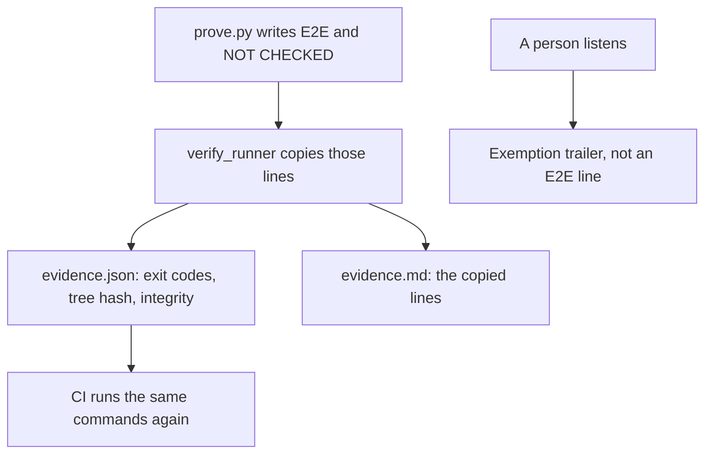

# 8. Run the real thing and prove it

A unit test can pass while the command a person will type does something else. The end-to-end check types the command. It writes a WAV, runs `pcmx gain --normalize`, checks the peak, writes a waveform PNG, and compares both outputs to committed bytes. Then it says, in lines a program can copy, what it did not do.

The intuition is a session log in a studio. The log says which take was printed, at what sample rate, and who has not listened yet. "Sounds good" from the person who bounced the file is not a line in the log. It is a note you may add later, and you label it as a note. The bounce is the take.

## The command

`python3 pcmkit/e2e/prove.py` is the command. It finds `pcmx` the same way the oracle does, builds a quiet-to-medium mono file with the Python writer, normalizes it, draws the PNG, and diffs the bytes against `pcmkit/golden/e2e_norm.wav` and `e2e_waveform.png`. `--update` rewrites those goldens. Same rule as module 5: a human reads the diff.

The stdout is the part the evidence file is allowed to trust as notes:

```text
E2E: pcmx gain --normalize and waveform match the committed goldens
NOT CHECKED: a person has not listened to this clip
NOT CHECKED: cargo-fuzz was not run
NOT CHECKED: Kani was not run
NOT CHECKED: this command does not re-run the Rust unit suite
```

Listening is [agentic manual testing](https://simonwillison.net/guides/agentic-engineering-patterns/agentic-manual-testing/) in Simon Willison's phrase: a person still uses the thing. This process cannot hear. The line stays `NOT CHECKED`. If you listened, the place to say so is a `Verified-by: none` trailer with an `Exemption-reason`, from module 4, or a sentence you add after the runner has written the file and that you do not disguise as an `E2E:` line. "Listened and it passed" as an `E2E:` line is the bluff the lab rejects.

```python
--8<-- "pcmkit/e2e/prove.py"
```

## How the runner copies the lines

`verify_runner` executes the commands in `checks.json` and records exit codes, hashes of the output, and a hash of the tree. While it has the stdout, it keeps lines that start with `E2E:` or `NOT CHECKED:` and writes them under the narrative heading. They are not part of the integrity hash. The hash covers the verdict, the problems, the commands, and the tree. Editing a narrative line, or forging `VERDICT: PASS`, still fails `audit_evidence_file`. An empty narrative is not a pass, and it is not a list of skips. The runner says that explicitly when no command printed those prefixes.

Skipped tests are a different fact. This end-to-end command does not parse `cargo test` and does not claim a skip count for the Rust suite. The Rust suite is a different check. If you need a skip count, print it from the command that ran the suite, as a line you are willing to have copied. Do not type `SKIPPED: 0` into the markdown because the suite felt green.



The tree hash is the one from module 4: contents, not timestamps, excluding the evidence files the runner is about to write. A golden update changes the hash. An old PASS does not cover the new bytes.

## What this run is not

It is not cargo-fuzz, not Kani, not Miri, and not a listening test. Those words appear in the output so a reader does not fill them in. The [verification note](https://claude.dev/blog/how-the-claude-code-team-thinks-about-verification/) treats a NOT CHECKED line as part of the record. The article's version asked the agent to type the file and then grepped it. The runner types the file from the commands. That is the correction module 4 made, applied here to a real `pcmx` invocation.

The verify skill tells Claude to quote the runner and not to invent the lines. Codex and Cursor do not load the skill. They load the instruction files, which already say to run the runner. CI runs `prove.py` without a model.

## Where the tools differ

!!! note "Codex and Cursor"

    `python3 pcmkit/e2e/prove.py` is a command any of the three tools can run. The hook that refuses a commit without a trailer is Claude's PreToolUse hook. A listening bluff typed into a Cursor chat never hits that hook. The evidence file CI rebuilds does. Put the command in `AGENTS.md` and in `.cursor/rules/verification.mdc`, and keep the bluff out of lines that start with `E2E:`.

## Try this

The agent writes `E2E: listened on laptop speakers and it passed` and leaves `NOT CHECKED:` blank.

??? success "What is missing, and what is false?"

    Missing: the byte comparison the program can do. False: the listening, presented as the end-to-end result. A blank `NOT CHECKED` hides the gap. The honest file has the golden line and names listening as not checked. A person who did listen can say so in a trailer. They do not get to relabel the golden line.

Next: the [lab](lab.md), the [quiz](quiz.md), and the [project](project.md).
