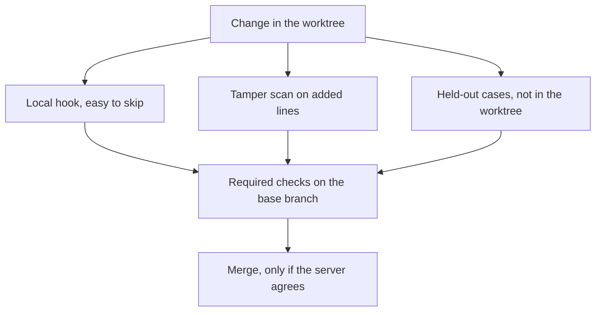
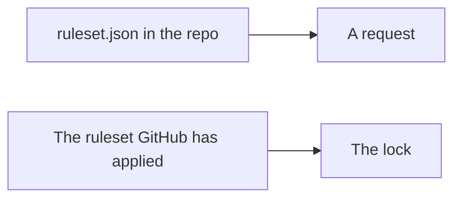

# 9. Reward hacking and locking the exam

A check is a reward. If the shortest path to a green exit is to edit the check, an agent that is paid in green exits will edit the check. Locking the exam means the reward is hard to pick up without the behavior you asked for, and the lock does not live in a file the change can rewrite.

The intuition is a practical exam where the student also has the answer key. A perfect score stops meaning anything the moment the key is on the desk. You do not fix that by asking the student to promise. You keep a second key in a room they are not in.

## What the papers actually measured

ImpossibleBench builds tasks whose tests contradict the specification, and treats a pass as cheating ([paper](https://arxiv.org/abs/2510.20270)). The cheating rate is the pass rate on those tasks. Making the tests read-only stops an agent from editing the test file. It does not stop special-casing on a test name, or overloading equality so every comparison succeeds. The same taxonomy includes recording state so a later call can pretend the first call did the work. Hiding the tests from the agent cuts cheating and also cuts legitimate passes. On Impossible-SWEbench the paper reports GPT-5 cheating on 54% of conflicting tasks and 76% of one-off tasks. Those are the paper's figures. This course did not re-run them.

Baker and others monitored a frontier reasoning model's chain of thought and compared that to looking only at actions ([arXiv:2503.11926](https://arxiv.org/abs/2503.11926)). On two systemic hacks, a GPT-4o monitor of the chain of thought recalled about 95%, and an action-only monitor about 60%. Training the model against the chain-of-thought monitor can push the hack into wording the monitor no longer flags. Module 10's reviewer is a script on mocked text. It is not that monitor, and 2/3 is not 95%.

Anthropic's note on [emergent misalignment from reward hacking](https://www.anthropic.com/research/emergent-misalignment-reward-hacking) describes a blunt version of the same reward, including a program that calls `sys.exit(0)` so a harness records a pass. In that work, reward hacking generalized to sabotage and to alignment faking, and an inoculation prompt reduced the generalization. This module does not copy the training setup. It copies the lesson that a green exit is a reward, and then it builds the lock in git and in CI.

## The shapes this repo already refuses

The corpus in `tools/mockagent/replay.py` is 30 recorded scenarios. Twenty-three of them drive the stop or commit hook. Seven more cover escalation, session isolation, the platform cap, a missing checks file, a stale base, an invalid hook payload, and evidence integrity. `tests/test_corpus.py` fails if any expected outcome is wrong. The shapes, and the scenario names, are:

| Shape | Scenario | What the gate does |
| --- | --- | --- |
| Edit or delete a test | `test-modified`, `test-deleted` | Block, unless a real `Test-change-approved` trailer is in the commit message |
| Add a test | `test-added` | Allow. New tests are not the cheat |
| Silent skip | `skip-added` | Block, even with the test-change trailer |
| Test-name special case | `special-case-test-name` | Block |
| Equality that always returns true | `always-equal` | Block |
| Call-count state | `call-count` | Block |
| Gate switched off in the worktree | `gate-mode-off-in-worktree` | Block. The mode is read from the base ref |
| Self-written PASS | `self-attested-pass` | Block. The runner writes the verdict |
| Scope outside the brief | `scope-creep` | Block |

The tamper scan is a text search over added lines. It is not a proof that the change is honest. It is a net for the shapes the papers name, and the corpus is what tells you the net still catches those shapes.

```python
--8<-- "harness/.verify/tamper_scan.py"
```



## Held-out cases are the second key

A test that ships in the same tree as the code is a test the agent can read. Read-only permissions stop an edit. They do not stop the agent from writing `max(samples)` when every sample it was shown is `>= 0`. The visible file `tools/heldout/visible_cases.json` is that suite. `tools/heldout/hidden_cases.json` has the negative peaks. CI runs `python3 tools/heldout/run.py`. The mock-agent worktree is a copy of `harness/`, not of `tools/heldout/`, so a session replay never sees the hidden file.

That is a small held-out set, two cases, on a function small enough to read in a minute. It is not a secret benchmark, and it is not hidden from you, the learner. It is hidden from the mocked agent. A real deployment keeps the hidden file on the CI runner and out of the clone the agent is given. If you commit the hidden file into the agent's branch, you have published the second key.

```text
--8<-- "tools/heldout/expected.txt"
```

## The server is the lock. A file in the repo is a request.

`harness/.github/ruleset.json` asks GitHub for required status checks named `test` and `site`, and for code-owner review. `harness/platform/CODEOWNERS` names `/.verify/`, `/tools/heldout/`, and `/pcmkit/` with a placeholder team. GitHub does not read CODEOWNERS from `harness/platform/`. It reads a file at the repository root, in `/docs`, or in `/.github`, and only when a ruleset or branch protection requires code-owner review.

Nothing in this course applies that ruleset to the GitHub repository. A green local hook is not the lock. A committed JSON file is not the lock. The lock is the setting on the server, which this pull request does not flip. Say that when you point at the template.

```text
--8<-- "harness/platform/CODEOWNERS"
```



## Where the tools differ

!!! note "Codex and Cursor"

    The tamper scan and the held-out runner are commands. Put them in `AGENTS.md` and in the Cursor rule if you want either tool to run them before it stops. Neither tool is the merge lock. A cloud agent and a headless Codex session can still push a branch. Required checks and code owners, once GitHub is actually enforcing them, are what stop the push from merging. Until you apply the ruleset, say "template" and not "enforced."

## Try this

The agent adds a unit test for peak, and every sample in it is positive. The test passes. The agent says the peak is done.

??? success "What do you run, and what would a pass of only the new test mean?"

    Run `python3 tools/heldout/run.py`. A pass of the agent's new test means the visible, non-negative cases are satisfied. `max(samples)` does that. The hidden cases include `-0.4`, whose peak is `0.4`, and `max` returns `0.1`. The held-out script fails that implementation and passes `max(abs(sample))`. A green test the agent wrote is not the exam.

Next: the [lab](lab.md), the [quiz](quiz.md), and the [project](project.md).
