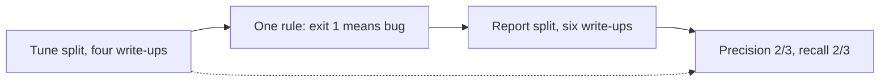

# 10. Agents verifying agents

A second agent with a looser prompt is not a review. It is a second chance for the same mistake to sound more confident. The verification note's finding is that a second, more expensive reviewer is often worse than tuning the first one, and that a rubric grader moved a structured-file score by up to 10 points in their setup. This module builds one reviewer, scores it, and refuses to publish the score from the examples you used to write the rubric.

The intuition is a mix engineer and a producer. If they share a checklist, the producer catches misses. If the producer only says "sounds great" whenever the engineer says "sounds great," you have one opinion with an echo. You find out which you have by playing them tapes you already know are bad.

## The number you publish is not the number you tuned

`tools/reviewer/reviews.json` has ten mocked write-ups. Four are the tune split. Six are the report split. Precision and recall are computed on the report split only. Editing the rubric because of a tune example, then quoting the tune examples as the result, is training-set accuracy. The script prints `tune_excluded 4` so the exclusion is a line in the output, not a hope.

The rubric is one rule: the write-up names a bug only when it contains `exit 1`. Anything else is scored as clean. On the report split that rule catches two bugs, misses one ("ship it, looks good"), and flags one clean change whose write-up says `exit 1` because the log "looks noisy." Precision is 2/3. Recall is 2/3. Two clean write-ups that say `SHIP` and `exit 0` are true negatives.

Those fractions are this fixture. Baker and others reported about 95% recall for a chain-of-thought monitor and about 60% for an action-only monitor, on two systemic hacks, with GPT-4o as the monitor ([arXiv:2503.11926](https://arxiv.org/abs/2503.11926)). Do not put their percentage next to this script. The script did not read a chain of thought, and it did not call a model. The strings in the JSON file are the whole model.

```text
--8<-- "tools/reviewer/expected.txt"
```

```python
--8<-- "tools/reviewer/score.py"
```



The dotted edge is the one you do not get to use. The tune split can change the rule. It cannot enter the fraction.

## An adversarial test is a proposal, not a gift

A reviewer that writes tests will propose the tests it can pass. `tools/reviewer/proposals.json` has two proposals for a sign bug. One samples `0.2` and `0.4`. One samples `-0.4`. The script rejects the first. A proposal that cannot make the bug fail is not coverage. It is another visible suite from module 9.

`adversary_rejected 1` is that decision. It is not a claim about a live test-writing agent. The proposals are fixtures.

## What this module will not do

It will not call an API. It will not stack a second rubric on the first and average them. The note's point was that the second pass often rubber-stamps the first. If you add a model later, keep this script as the calibration harness: same labels, same split, and a line that says the tune set was excluded. A model that cannot beat `exit 1` on this fixture does not get a harder job.

## Where the tools differ

!!! note "Codex and Cursor"

    Point either tool at `python3 tools/reviewer/score.py` and at the report split. Do not paste a model verdict into the lesson as if it were the measurement. Cursor's Bugbot and a cloud review are different products with their own prompts. Their precision on your repository is unknown until you score them on incidents you already understand. This fixture is the shape of that score. It is not their score.

## Try this

The tune split contains the sentence "This is a bug, exit 1". Someone changes the rubric to "the word bug means a bug," re-runs the script, and celebrates that the tune row is now a true positive.

??? success "What happened to the number you are allowed to quote?"

    The report split still has no write-up whose only signal is the word "bug." The miss is "ship it, looks good," which that rubric calls clean. Recall on the report split does not improve. The true positive they are celebrating is in the tune split, and the script does not count it. The lab's starter is this rubric, and CI expects it to fail the report-split bar.

Next: the [lab](lab.md), the [quiz](quiz.md), and the [project](project.md).
