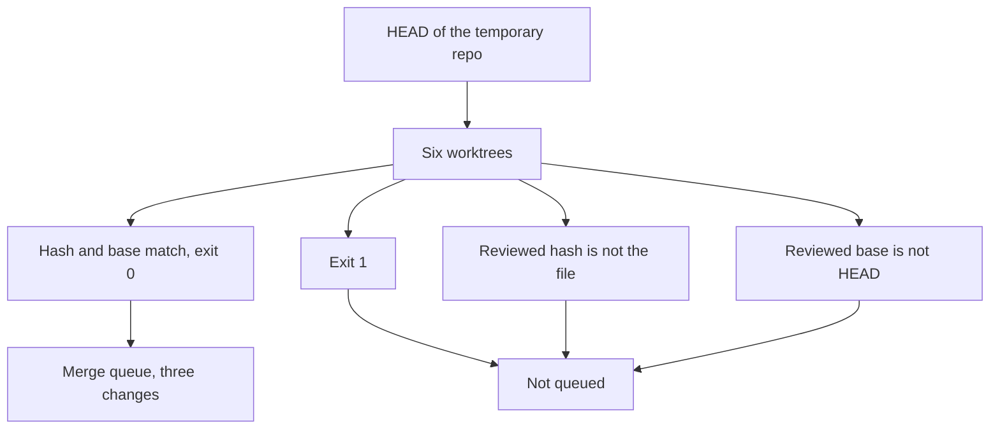

# 11. Orchestrating parallel agents

One agent in one checkout will eventually edit a file another agent is editing. The fix is an old one: give each agent a worktree, give each worktree a base commit, and refuse a review that names a different tree than the one you are about to merge. Parallelism is not a reason to skip the gate. It is a reason the gate has to say which tree it ran on.

The intuition is a studio with six rooms. Each room has a copy of the session. The mix you release is not "whatever finished last." It is the takes whose notes match the reel that is actually on the machine.

## Six worktrees, one process, a budget of eight

`python3 tools/orchestrator/run.py` creates a temporary git repository and adds six worktrees. Each worktree gets a `change.txt`. The tree hash is the SHA-256 of that file. A review is admitted only when three things hold: the reviewed hash is that tree hash, the reviewed base is the current `HEAD`, and `check_exit` is 0. The script then deletes the temporary repository.

The six rows are fixtures, not model sessions. One fails the check (`hold`). One was reviewed against a hash that is not the file (`stale`). One was reviewed against a base that is not `HEAD` (`stale-base`). Three go to the queue. The budget is eight sessions. A ninth raises before any worktree is created. Eight is also the platform continuation cap from module 4. The same number is doing a different job here: it caps how many agents you start, not how many times one agent may be told to keep going.

This mock is one Python process. A live run would be one agent process per worktree, which is what Claude Code's headless mode, Codex cloud, and a Cursor cloud agent are for. Those products are cited on the references page. This course does not start them, and it does not call their APIs. The decisions in the script are the ones those products still have to get right: which tree, which base, which exit code.

```text
--8<-- "tools/orchestrator/expected.txt"
```

```python
--8<-- "tools/orchestrator/run.py"
```



## A merge queue is a base check you repeat

GitHub's [merge queue](https://docs.github.com/en/repositories/configuring-branches-and-merges-in-your-repository/configuring-pull-request-merges/managing-a-merge-queue) updates a pull request onto the latest base and re-runs checks before it merges. The `stale-base` row is the small version of skipping that. The review was fine for the commit it named. That commit is not `HEAD` anymore. Queuing it anyway merges a review of the old tree.

This repository's workflow does not enable a merge queue. The script simulates the refusal. Turning the feature on in GitHub settings is a separate step, and this course does not do it.

## Isolation is the worktree, not a polite prompt

Two agents asked to "stay in your files" will still both edit `lib.rs` if both briefs need it. The worktree means those edits are two commits you can look at, not one interleaved working tree. It does not mean the edits are correct. The hold row is a correct isolation of a bad change. Isolation without a check is six rooms shipping six bugs.

The scope check from module 2 still applies inside each room. A worktree is not an excuse to write outside the brief. The orchestrator here does not re-implement scope. It assumes the per-tree gate from modules 4 and 9 already ran, and it records the exit code the fixture claims. When you wire this to a real agent, that exit code has to be the runner's, not the agent's summary.

## Where the tools differ

!!! note "Codex and Cursor"

    Codex cloud and a Cursor cloud agent each take a branch or a worktree-shaped checkout. Tell them the acceptance command. Do not tell them to merge. The queue in this module admits a row. It does not push. Headless Claude Code can run the same command in each worktree if you start it yourself. Starting eight of them against a live model is outside this course: there is no API key, and the fixtures are the agents. If a tool offers a merge button, the stale-base row is the reason you still want CI on the updated base.

## Try this

Agent 4's review says the tree hash it saw, and the file on disk is one line longer. The check exit in the review is 0.

??? success "Does it queue?"

    No. `decide` compares the reviewed hash to the hash of the current body and returns `stale` before it looks at the exit code. A green review of a tree you no longer have is a review of a different change. The lab's starter admits it. The solution does not.

Next: the [lab](lab.md), the [quiz](quiz.md), and the [project](project.md).
