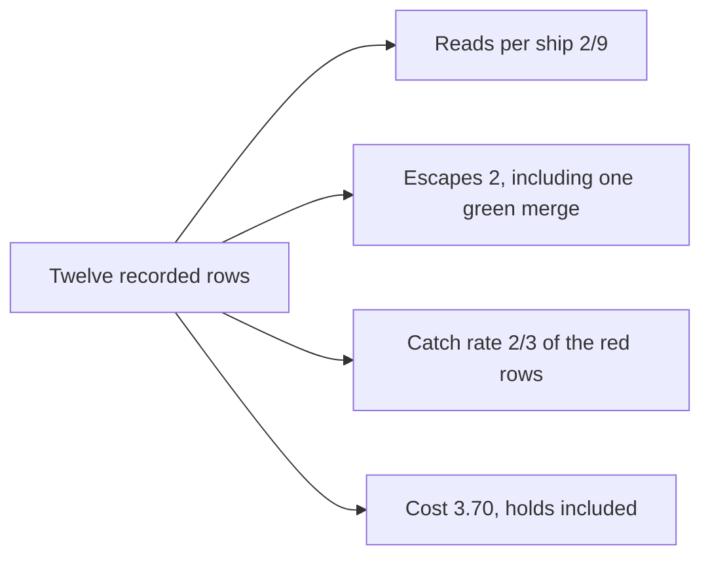

# 12. Metrics and the ratchet

You cannot steer a harness you only describe. The counts that change a decision are small: how many shipped changes a person still had to open, how many shipped changes were wrong anyway, what it cost, how long it took, how often the gate stopped a good change, and how often it caught a bad one. A miss that does not become a check will happen again. A check you delete because it has been quiet will be missing on the day you needed it.

The intuition is a click track you almost muted because the song had no clicks for a minute. The click is the downbeat. Quiet is not the same as unused.

## One recorded week

`tools/metrics/runs.json` is twelve rows, not a production fleet. Nine merged. Two of those nine were opened by a person, so reads per ship is 2/9. Two of the nine were later wrong, so the escape count is 2. One escape (`d`) merged with `check_exit` 0. The checks were green and the change was still wrong. The other (`k`) merged with `check_exit` 1. That is a bypass, and catch rate is how you see it: of the three red rows, two were not merged, so catch rate is 2/3. Catch rate does not see `d`. Escape count does. You want both numbers.

Cost is the sum of `cost_usd` on every row, shipped or not, because a held change still spent the money. The fixture sums to 3.70. Median minutes is taken over ships only: nine values, the middle one is 11. False holds are green changes a person stopped. There is one (`j`), and the denominator is that false hold plus the red rows that were actually held (`i` and `l`), so the rate is 1/3.

None of these is a benchmark of Claude, Codex, or Cursor. They are the arithmetic of this file. If you replace the file, the script prints different fractions, and CI will fail until `tools/metrics/expected.txt` moves with it on purpose.

```text
--8<-- "tools/metrics/expected.txt"
```

```python
--8<-- "tools/metrics/report.py"
```



## Quiet is not a deletion criterion

The source article prunes a check that has not fired in 60 days. Sixty days is the author's number. The verification note says the list gets tidied. It does not say sixty. `tools/metrics/report.py` uses 60 so the argument is about that window, and then it refuses to drop a check marked catastrophic.

In the fixture, `format` has been quiet for 90 days and is not catastrophic, so it is pruned. `tamper` has been quiet for the same 90 days and is catastrophic, so it stays. `held-out` is young and stays. A tamper scan that has not seen a cheat for a quarter is the scan you will miss the day an agent adds `pytest.skip`. Deleting it because the dashboard looks cleaner is how the ratchet runs backwards.

A miss becomes a check when you can name the command that would have failed. Module 9's negative peak is that story in miniature: the visible suite missed it, and `tools/heldout/hidden_cases.json` is the check that exists because of the miss. Writing "we should watch for this" in a retrospective is not the ratchet. The new row in `checks.json` is.

## What you still read by hand

Reads per ship is not a target of zero. A change that touches a locked path, a public ABI, or anything you cannot regenerate from a test deserves a person even when every command exited 0. The 2/9 in this fixture includes opens of green ships. That is the point. The metric asks whether the opens are the ones you meant, not whether you can drive the number down by not looking.

## Where the tools differ

!!! note "Codex and Cursor"

    Either tool can run `python3 tools/metrics/report.py` and paste the nine lines into a pull request. Pasting a different fraction from memory is a new number you did not measure. Ask the tool to delete a quiet check and then read the diff. If `tamper` disappeared, the tool applied the article's prune and ignored the catastrophic flag. Put the flag in the instruction file in one sentence: a check marked catastrophic is not eligible for the 60-day prune.

## Try this

`format` has not failed in 90 days. Someone deletes it, and the next pull request is slightly faster.

??? success "What did the speed cost, and what must not be deleted the same way?"

    You lost a check that was marking style, which may be acceptable if another formatter still runs. You do not get to make that trade for `tamper`. The pruner in the script drops `format` and keeps `tamper` for the same quiet window. The lab's starter drops both. CI expects the starter to fail.

Next: the [lab](lab.md), the [quiz](quiz.md), and the [project](project.md).
