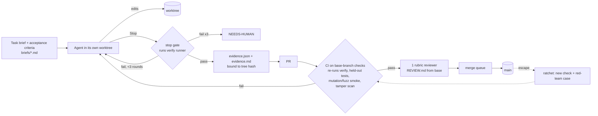

# Proposal: Verification Engineering for AI Coding Agents

*An original, hands-on course for Arunkumar Maniam Rajan (GitHub: pragmaticarun)*
*Status: PROPOSAL ONLY. No repo or site has been created. Drafted Tue 24 Nov 2026 (IST).*

---

## 0. TL;DR

- **Source:** the X Article by @0xarcos, *"Verification Engineering: The $400K Skill of Running 30 Fable 5.2 Agents (Full Course)"*, posted 18 Nov 2026, 18:30 IST. **We have the full body.** The X API returned it in `article.plain_text`, about 16K characters plus all 18 code blocks.
- **Verdict on the article:** the core ideas are sound and mostly trace back to a real Anthropic post, *"How the Claude Code team thinks about verification"* (Addy Osmani, claude.dev, 16 Nov 2026), and to the Claude Code docs. The "file by file" system, though, is **the author's own reconstruction, not Anthropic's files**. It also has real holes: the agent writes its own PASS, the agent can switch the gate off, any commit can exempt itself, and "tests are locked" is promised but the code doesn't lock them. Its headline numbers (the $400K salary, 30 agents and 4 reports) can't be verified, and the "last month" timeline doesn't fit Fable 5.2's 9 Nov release date.
- **The course:** 12 modules plus a capstone, built around one running project. That project is **`pcmkit`**: a small Rust PCM/WAV audio library with a CLI, a C ABI with a C++ consumer, and Python oracles. Every module ships tested, runnable files. CI replays **mocked agent sessions**, so it needs no API keys. A **red-team corpus of "cheating" patches** proves the harness catches each fake.
- **Stack:** one public repo, `pragmaticarun/verification-engineering-course`, holding both the site and the examples. The site uses **Zensical**, the successor to Material for MkDocs, which reads `mkdocs.yml`. Material for MkDocs itself is the fallback, but it reaches end of life on 5 May 2027. GitHub Pages deploys through Actions, and heavy tools run only in CI.

---

## 1. The source article: what it says

### 1.1 Retrieval
- The `x` MCP `get_posts_by_id` call (id `2123038548580245659`) returned the title, the full `plain_text` body (~15,961 characters), and all code blocks: CLAUDE.md, SKILL.md, `stop_gate.py`, `commit_gate.py`, `triggers.py`, `checks.json`, `settings.json`, `gate.json`, the evidence.md sample, the "lazy prompt", and the fake/symptom tables. The 8 inline images weren't needed because their content repeats the code blocks and tables.
- Author: "Arcos" (@0xarcos). Bio: "ur fav researcher ai and creator". The article calls itself "Field Manual Nº 003".

### 1.2 Structure (sections as published)
| # | Section | Gist |
|---|---|---|
| intro | Hook | "$400K skill"; went from 3 agents to "30 Fable 5.2 agents, read 4 reports"; says Claude writes and reviews ~90% of Claude Code; Osmani and Karpathy framing; "Prompts → Agents → Harness → Loops → Graphs → Verification" |
| 00 | 30-second version | done = exit code; checks live where the change can't touch them; run the real app; a Stop hook until evidence.md says PASS; 3 fails → human; read one evidence file per change; every miss becomes a checklist line; one worktree and session per agent |
| 01 | "Done" is a claim | anecdote: six green ticks, but login broke on the 2nd try and the rate limiter never fired; "the agent grades its own exam" |
| 02 | 7 ways an agent fakes "done" | NO-OP TEST, TEST EDIT, HAPPY PATH, SELF REVIEW, MOCK WORLD, SILENT SKIP, SCOPE CREEP, each paired with the check that catches it |
| 03 | A check the change can edit is a suggestion | REVIEW.md read from the base branch; read the checklist with `git show main:`; fail any change that touches checks, hooks or the skill; stamp each commit with `Verified-by` |
| 04 | "Just add a second reviewer" | stacked reviewers share blind spots; one reviewer with REVIEW.md, building on earlier rounds; a rubric grader added up to 10 points; "Facts first. Verdicts second. Vibes never." |
| 05 | 3 tests worth your tokens | E2E, property (Hypothesis/fast-check/proptest), differential; Boris Cherny's Lean verification of the Agent SDK (16 PRs) |
| 06 | Run the change, not just the tests | a `verify` skill; Simon Willison's "agentic manual testing" |
| 07 | Build it in 30 minutes | the "lazy prompt", then 7 steps: CLAUDE.md, verify skill, checks.json, triggers.py, stop gate, commit gate (observe first), Verified-by stamp |
| 08 | One real run | "remember me" feature; the stop gate bounces it; the E2E run catches a cookie that survived logout; a 12-line evidence.md |
| 09 | Start every gate in observe mode | off → observe → enforce; read gate.log weekly; enforce lets the 3rd try through |
| 10 | Every miss becomes a rule | Anthropic's process (≥2 PRs, 3 agents try to disprove, human approves); the simpler checks.json ratchet; flaky tests are fixed or deleted; prune after 60 quiet days |
| 11 | Which check are you missing? | symptom → missing check table |
| 12 | The only number | "reads per ship" (goal < 0.1) and "escapes" |
| 13 | Can / can't | limits: checks are only as good as checks.json; keep human eyes on payments, auth and deletion; costs tokens; `/security-review` |
| 14 | One-evening protocol + checklist | a 50-minute setup and an 11-item checklist |

### 1.3 The file-by-file system it describes
```
your-repo/
  CLAUDE.md                        "Done means proven" rules
  .claude/skills/verify/SKILL.md   run tests, run triggers.py, drive the real app, write evidence.md
  .claude/hooks/stop_gate.py       Stop hook: exit 2 unless evidence.md (newer than last edit) says PASS; 3 tries then NEEDS-HUMAN.md
  .claude/hooks/commit_gate.py     PreToolUse(Bash): on "git commit", require PASS + Verified-by; modes off/observe/enforce
  .claude/settings.json            registers both hooks
  .verify/checks.json              {id, when[globs], check, why}; diff-triggered reliability checks
  .verify/triggers.py              reads checks.json via `git show main:`; fails if LOCKED files changed; prints triggered checks
  .verify/gate.json                {"mode": "observe"}
  .verify/evidence.md              VERDICT / CHANGE / TESTS / TRIGGERED / E2E / NOT CHECKED / VERIFIED-BY
```

---

## 2. Claim check against primary sources

Legend: ✅ confirmed · 🟡 partly confirmed, or paraphrased with nuance · ❌ wrong or contradicted · ❔ unverifiable

| Article claim | Status | Evidence / note |
|---|---|---|
| "Fable 5.2" is a real model | ✅ | Anthropic announced Claude Fable 5.2 and Mythos 5.2 on **9 Nov 2026** [A1]. |
| "Last month I ran 30 Fable 5.2 agents" (posted 18 Nov) | ❔/❌ timeline | "Last month" would be October, which is before the public 9 Nov release. That only works with pre-release access, which the article doesn't claim. Treat it as an anecdote. |
| "$400K+ a year for one skill", "$2,000 bootcamps" | ❔ | No source is given. Marketing framing; we won't repeat it. |
| ~90% of Claude Code's code is written and reviewed by Claude | ✅ | [A2], [A3]. |
| The quote attributed to Addy Osmani ("bottleneck shifts to proving that it works") | 🟡 | The substance is confirmed. The subtitle is "The bottleneck has moved from writing code to knowing it's correct" [A4]. The article's exact wording wasn't found verbatim. |
| Karpathy: agents "basically didn't work before December and basically work since" | ✅ | Feb 2026 quote [A5]. That quote does not contain the article's "work best on tasks where you can verify" line. The closest primary source is Karpathy's *Verifiability* (Nov 2025): "Software 2.0 easily automates what you can verify" [A6]. |
| Karpathy "asked for proof next to the answer two years ago" | ❔ | Not located. |
| REVIEW.md is read from the base branch, never from the PR | ✅ | It's a feature of the Code Review product, and it **depends on branch protection** [A7], [A2]. |
| A verify skill in `.claude/skills/`, used before commits | ✅, with an update | [A2]. Current Claude Code also **ships a bundled `/verify`**, and a repo-root `.claude/skills/verify/SKILL.md` **replaces** it [A8]. The article doesn't mention this. |
| 39-item reliability checklist, diff triggers, usually 3–10 per change | ✅ | [A2]. |
| 3 failed rounds → human | ✅ | [A2]. |
| Stacking a second, pricier reviewer is often worse than tuning one | ✅ | [A2]. |
| "Models tend to leave a teammate's work as it is, even when it's wrong" | ❔ | Not in the fetched sources. |
| A rubric grader added up to 10 points on structured file generation | ✅ | [A2]. |
| Commit stamp includes "none" | ✅ | [A2]. The stamp's format isn't published, so `Verified-by:` is the author's choice. |
| Commit gate with off/observe/enforce; the 3rd try is allowed | 🟡 | The modes and the "blocked twice, then allowed" rule are confirmed [A2]. **But Anthropic's gate checks whether the session contained `/code-review` or `/verify`.** The article's gate checks for a string in a file the agent writes itself, which is a weaker design. |
| Rules-from-misses process (≥2 PRs, 3 agents try to disprove, human PR) | ✅ | [A2]. Anthropic also replays 3 bug finders against known-incident PRs [A2]. |
| Flaky tests: no skip, no sleeps, no retry-until-green; delete and document | ✅ | [A2]. |
| "Prune every check that hasn't fired in 60 days" | 🟡 | Anthropic says only that it tidies these "on a routine" [A2]. The 60 days is the author's number, and it's risky for rare but catastrophic incident classes. |
| Boris Cherny formally verified the Agent SDK in Lean; 16 PRs | ✅ | [A9]. The model was **Opus 5.5**, and he also used TLA+. Caveat: proofs are about a *model* of the code [A9 comments], [A10]. |
| Stop hook exit 2 keeps Claude working; PreToolUse with a Bash matcher | ✅ | [A11]. The article omits `stop_hook_active` and Claude Code's **built-in 8-consecutive-continuation cap** [A11]. |
| Claude Code has a built-in security review | ✅ | `/security-review` [A12]. |
| Simon Willison: "agentic manual testing" | ✅ | [A13]. |
| Property tests "kill NO-OP TEST" because inputs aren't written by the agent | 🟡 | The generators and properties are usually written by the same agent, so its blind spots can carry over. **Mutation testing** is the direct detector for tests that can't fail [T1], [T8]. |
| "Locked checks" catch TEST EDIT | 🟡 | ImpossibleBench: read-only tests stop direct edits but **not** special-casing, operator overloading or state-recording hacks [R1]. Held-out tests and CI re-execution are needed. |
| "Hard to fool" E2E, property and differential tests are the three to invest in | ✅ | [A2], [A4]. |

### 2.1 Defects in the article's own files (we'll teach these as exercises)
1. **Self-attested evidence.** `stop_gate.py` and `commit_gate.py` only grep for `VERDICT: PASS` in a file *the agent writes*. Nothing runs a command. That is "SELF REVIEW" with extra steps.
2. **Freshness by mtime.** The check is "evidence newer than last edit", and `touch` beats it. Evidence should instead be bound to a content hash of the tree or diff.
3. **The gate can be switched off by the gated agent.** `LOCKED` doesn't include `.claude/settings.json` or `.verify/gate.json`, so a change can set the mode to `off` or unregister the hooks.
4. **Self-exemption.** If `"Verified-by: none"` appears anywhere in the command string, the commit is let through with no reason checked.
5. **"No change can touch tests" is promised but not implemented.** `LOCKED` omits test directories. A naive lock would also block *adding* tests, so we need a real policy: add freely, but modifying or deleting an existing test needs an owner.
6. **Fail-open.** If `main` has no `checks.json`, `triggers.py` silently triggers nothing. It also uses the local `main`, which may be stale in a worktree.
7. **Local hooks aren't enforcement.** They only see Claude's Bash `git commit`. Humans, other tools, or `git -c … commit` get around them. The real lock is **server-side**: required CI, branch protection or rulesets, and CODEOWNERS [A3], [G1], [G2].
8. **The `.tries` counter is per repo, not per session**, and it ignores `stop_hook_active`.
9. **SCOPE CREEP → "file list"** appears in the table, but no file-list check exists in any file.
10. **The property-test example is weak.** "Balance never negative" with only non-negative deposits is near-vacuous: it never exercises withdrawals or overdraft rejection.

---

## 3. Course design

### 3.1 Learner and goals
**Learner:** an experienced Android and multimedia engineer (C++, Rust, Python; Ubuntu) who wants to run many coding agents without reading every diff.

**By the end you can:** design, build, *test*, and measure a verification harness that lets N parallel agents ship changes to a real repo. You read evidence, not diffs, and you have numbers showing it works.

### 3.2 Teaching style
- **Intuition first** (Andrew Ng style): each module opens with a one-paragraph "why", a concrete failure story from `pcmkit`, and a Mermaid diagram, and only then gets to tools.
- **Everything is runnable and tested.** Every template, hook, and workflow on the site is copied from a file that CI executes. Snippets are included from source files rather than pasted, so the docs can't drift from the code.
- **End-to-end walkthroughs:** each module ends with a recorded "agent session" (a mocked transcript plus patches) running through the harness.
- **Exercises with hidden solutions:** collapsible `??? success "Solution"` blocks on the site. Solution code lives in `solutions/`, and CI asserts that **starters fail and solutions pass**, which applies the course's own principle to the course.
- **Quizzes:** 5–8 questions per module as collapsible answer blocks (pure Markdown, no JS plugin).
- **One project per module** that builds up `pcmkit`'s harness, ending in the capstone.

### 3.3 Running example: `pcmkit`
A small but real media library that fits your background and exercises every layer:
- **Rust core** (`pcmkit`): WAV parse/write, sample-format conversion (i16/i24/f32), gain with clamping, mixing, simple resampling, and peak/RMS stats.
- **CLI** (`pcmx`): `info`, `convert`, `gain`, `mix`, and `waveform` (renders a PNG). This is the E2E surface.
- **C ABI + tiny C++ consumer** (`ffi/`, `cpp/`): a real place for ASan/UBSan, clang-tidy, and contract tests across a language boundary.
- **Python oracles** (`oracle/`): a stdlib `wave`-based reference implementation for differential tests, plus Hypothesis properties against the CLI.

Why this domain: it has natural invariants (round-trip, idempotent conversion, clamping, no NaN), a parser worth fuzzing, unsafe conversions worth running under Miri, golden-file and visual outputs, and performance budgets.

### 3.4 The harness we build (an improved version of the article's)

Key differences from the article:
- **Evidence is generated, not written.** `verify run` executes commands and records exit codes, test counts (skipped counted), tool versions, and a tree hash into `evidence.json`. The agent only adds narrative fields (E2E notes, NOT CHECKED). **CI recomputes the evidence**, so local evidence is treated as a claim.
- **The lock is server-side.** Checks, hooks, gate config, and settings are read from base, gated by CODEOWNERS and a ruleset, with required status checks.
- **Test policy:** adding tests is free. Modifying or deleting existing tests requires an owner label. A tamper scanner flags ImpossibleBench-style hacks: test-name special-casing, `__eq__`/`PartialEq` overrides in non-test code, call-count state, and newly added skip or ignore markers.
- **A held-out acceptance suite** the agent never sees, run only in CI.
- **The harness is itself tested** with a red-team corpus of cheating patches, each with an expected verdict. We report a "harness catch rate" (and mutation score).

### 3.5 CI without API keys
- `tools/mockagent/` replays **scripted sessions**: JSON files of tool calls, file edits, and a final message, plus the hook-event payloads Claude Code would send, following the documented hook input schema [A11]. The hooks receive real-shaped stdin, and the gates make real decisions.
- `scenarios/` contains honest sessions and cheating sessions, one or more per fake: test edit, special-casing, skip added, `gate.json` flipped to off, a `settings.json` hook removed, a self-exempt commit, a stale-evidence touch, scope creep, and a mocked-out E2E.
- An optional `LIVE=1` local mode lets you point the same scenarios at a real agent (Claude Code headless `claude -p` [A14], Codex, or Cursor). It's never required in CI.

### 3.6 Site stack and repo layout
- **Site:** **Zensical**, built by the Material for MkDocs team, which builds existing `mkdocs.yml` projects and supports Mermaid natively [S1–S3]. Material for MkDocs is the fallback with identical Markdown, but critical maintenance only runs through **5 May 2027** [S4]. Admonitions and collapsible blocks handle exercises and quizzes, and snippets include tested source files. Deployment uses GitHub Pages via Actions (`upload-pages-artifact` + `deploy-pages`) [G3].
- **Low local disk:** the docs need only `pip install zensical` (~tens of MB). Rust uses a single shared `CARGO_TARGET_DIR`. Heavy tools (cargo-fuzz on nightly, Kani, Miri, sanitizers, mutation runs) live in **CI and an optional nightly workflow**, and local labs default to quick smoke runs. A `make doctor` step reports disk use.

```
verification-engineering-course/
├── mkdocs.yml                 # Zensical-compatible config (zensical.toml optional)
├── docs/                      # the site
│   ├── index.md  syllabus.md  setup.md  glossary.md  references.md
│   ├── m01-why-verification/ … m12-metrics-ratchet/   # index.md, lab.md, quiz.md, project.md
│   └── capstone/
├── pcmkit/                    # running example (Cargo workspace)
│   ├── crates/pcmkit  crates/pcmx  crates/pcmkit-ffi
│   ├── cpp/                   # C++ consumer + CMake, sanitizer presets, .clang-tidy
│   ├── oracle/                # Python reference impl + Hypothesis tests
│   ├── fuzz/                  # cargo-fuzz targets
│   └── tests/golden/          # golden WAV/PNG + insta snapshots
├── harness/                   # the deliverable you can copy into any repo
│   ├── AGENTS.md  CLAUDE.md  .cursor/rules/  REVIEW.md
│   ├── .claude/settings.json  .claude/hooks/*.py  .claude/skills/verify/SKILL.md
│   ├── .verify/checks.json  verify_runner.py  triggers.py  tamper_scan.py
│   └── .github/  (CODEOWNERS, rulesets JSON, PR template)
├── scenarios/                 # mocked agent sessions: honest/ and cheats/
├── tools/mockagent/  tools/metrics/
├── labs/mNN/{starter,solutions}/
└── .github/workflows/  site.yml  examples.yml  harness-selftest.yml  nightly-heavy.yml
```

### 3.7 Pace
12 modules at about 3–5 hours each (30–45 min reading, 2–3 h lab and project), plus a capstone of about 8–12 hours. That's roughly 55–70 hours total. Self-paced at 2 modules a week, it takes 6 weeks plus the capstone.

---

## 4. Syllabus

| # | Module | What you build on `pcmkit` |
|---|---|---|
| 1 | **Why verification beats review at agent scale**: trust model ("done" is a claim), review throughput math, Karpathy's verifiability, where human attention still goes. Includes setup. | Baseline: replay 10 mocked agent PRs and time manual review vs. a check script; first "reads per ship" number. |
| 2 | **Defining done**: specs, executable acceptance criteria, task briefs, plan files, feature lists as JSON, explicit non-goals and allowed-file lists. | Brief + acceptance tests for `pcmx gain --normalize`; a brief linter. |
| 3 | **Instructions, permissions and skills**: CLAUDE.md, AGENTS.md (Codex/agents.md), Cursor rules, nested scoping, deterministic vs. non-deterministic instructions, permission deny rules, protected paths, skills and slash commands, bundled `/verify`. | One source-of-truth instruction set that works across Claude Code, Codex and Cursor; deny rules for the harness dirs. |
| 4 | **Hooks and gates**: Stop/SubagentStop/PreToolUse semantics, exit codes, `stop_hook_active`, the continuation cap, off/observe/enforce, testing hooks with recorded events. | A corrected stop gate and commit gate, unit-tested against fixture events; we fix the article's 10 defects. |
| 5 | **Fast deterministic layers**: types, clippy/rustfmt, clang-tidy, ruff/mypy, unit tests with nextest, golden and snapshot tests (insta), contract tests across the C ABI, flaky-test policy. | A layered `verify fast` (<60 s) with golden WAV/PNG and FFI contract tests. |
| 6 | **Tests the agent can't fool**: property tests (proptest, Hypothesis), differential tests against an oracle, coverage-guided fuzzing (cargo-fuzz/libFuzzer), mutation testing as test-of-tests (cargo-mutants, mutmut). | Round-trip and idempotence properties, a Python-oracle differential, a WAV-parser fuzz target, and killing surviving mutants. |
| 7 | **Native code and light formal methods**: ASan/UBSan/TSan, Miri for unsafe Rust, Kani bounded proofs, criterion perf budgets; Lean/TLA+ in practice and the gap between model and code. | Sanitizer CI preset for the C++ consumer, Miri on sample conversion, a Kani proof that `gain` never overflows, and a perf gate. |
| 8 | **Run the real thing and prove it**: E2E and "agentic manual testing", a verify skill that drives the CLI, visual diffs, an Android/emulator note, generated evidence bound to a tree hash, `Verified-by` git trailers, the NOT CHECKED discipline. | `verify_runner.py` producing evidence.json + evidence.md, and a verify skill for `pcmx`. |
| 9 | **Reward hacking and locking the exam**: test edits, special-casing, operator overloading, state recording, silent skips, mock-world, scope creep; base-branch checks, CODEOWNERS, rulesets, held-out tests, tamper scanning. | A red-team corpus of cheating sessions, and a harness that catches all of them in CI. |
| 10 | **Agents verifying agents**: fresh-context reviewer subagents, REVIEW.md rubrics, adversarial test-writer agents, independent re-implementation, calibrated LLM-as-judge (incident-based eval set, control set, per-stage recall), avoiding shared blind spots. | A rubric reviewer calibrated on mocked outputs with measured precision and recall; an adversarial test-writer loop. |
| 11 | **Orchestrating parallel agents**: decomposition into verifiable units, worktrees, sandboxes and cloud agents (Claude Code, Cursor, Codex), headless runs, GitHub Actions, merge queues, escalation rules, budgets. | An orchestrator that runs 4–8 mocked agents in worktrees through gates, CI and a merge queue. |
| 12 | **Metrics and the ratchet**: escape rate, reads per ship, verification cost and latency, gate false-positive rate, harness catch rate and mutation score; turning misses into checks; principled pruning. | A metrics dashboard from git trailers and CI data; an escape-to-check workflow. |
| C | **Capstone**: a full harness on a real repo (`pcmkit`, or one of yours), several parallel agents (live optional, mocked by default), with measurements. | Before/after report: reads per ship, escapes, cost, latency, catch rate; a write-up published on the site. |

---

## 5. Mapping: source article → our module → what we improve or correct (module by module)

| Our module | Article section(s) it draws on | What we keep | What we improve / correct |
|---|---|---|---|
| **M1 Why verification** | Intro, 00, 01, "The shift" | "Done" is a claim; humans read evidence, not diffs | Drop the unverifiable $400K and 30-agents framing and flag the Fable 5.2 timeline. Ground the argument in Anthropic's review data (PR volume doubled while the revert share fell >40%) [A3] and Karpathy's verifiability [A6]. Add the review-throughput math the article only asserts. |
| **M2 Defining done** | 01 (Osmani's "define done"), 13 ("vague goal") | Done must be machine-failable | The article has no brief, spec or acceptance-criteria artifact. We add brief templates, executable acceptance tests written *before* the code, non-goals, and allowed-file lists (which deliver the "file list" the article promised for SCOPE CREEP), plus feature lists from Anthropic's long-running-harness post [A15]. |
| **M3 Instructions & permissions** | 07 Step 1 (CLAUDE.md), Step 2 (skill) | Short rule file; a verify skill | The article is Claude-only. We cover AGENTS.md (agents.md spec, Codex discovery and size limits) and Cursor rules [O1–O3]. We explain what belongs in instructions versus hooks [A16], use permission deny rules and protected paths [A17], and note the bundled `/verify` that a repo skill replaces [A8]. |
| **M4 Hooks & gates** | 00, 07 Steps 5–6, 09 | Stop gate, commit gate, off/observe/enforce | We fix the per-repo `.tries` counter, add `stop_hook_active` and the 8-continuation cap [A11], close the self-exemption by requiring a reason on `Verified-by: none`, lock `settings.json` and `gate.json`, and replace mtime freshness. Every hook is unit-tested against recorded events. |
| **M5 Fast layers** | 05 intro (flaky/slow tests), 10 (flaky policy) | No sleeps, no retry-until-green | The article skips types, linters, snapshots and contract tests entirely. We add a layered fast tier, Rust/C++/Python linters, insta golden files, and FFI contract tests [T5]. |
| **M6 Can't-fool tests** | 02 (NO-OP), 05 (property, differential) | Property and differential tests | We correct the claim that property tests "kill no-op tests": agent-written generators share its blind spots, so we add **mutation testing** as the direct no-op detector [T1], [T8] and fuzzing [T3], [T4]. The weak ledger property is replaced with a real one. |
| **M7 Native & formal-lite** | 05 (Boris/Lean) | Formal methods are getting practical | Corrected facts: the model was Opus 5.5, with Lean *and* TLA+ [A9]. We add the gap between model and code [A10] and give a Rust/C++ path the article lacks: sanitizers [T6], Miri [T9], Kani [T10], criterion perf budgets [T11]. |
| **M8 Run it & prove it** | 06, 07 (evidence.md), 08, Step 7 (stamp) | E2E first; evidence file; NOT CHECKED line; Verified-by stamp | **Evidence is generated by a runner and recomputed in CI, not typed by the agent.** It's bound to a tree hash, and skipped tests are counted mechanically. We use real git trailers and a domain E2E (CLI + golden audio + waveform PNG) [A13], [A2]. |
| **M9 Reward hacking & locks** | 02, 03, 07 Step 4, 11 | The change can't edit its judge; read checks from base | Local `git show main:` is only advisory. We use server-side locks (CODEOWNERS, rulesets, required checks, Code Review's base-branch REVIEW.md) [G1], [G2], [A7]; held-out tests; and tamper scanning for the 4 ImpossibleBench hack types [R1]. We add a real test-change policy, since "no change can touch tests" was promised but not implemented. Literature: [R1–R3]. |
| **M10 Agents verifying agents** | 04 | One reviewer with a rubric beats stacked ones; facts > verdicts > vibes | We add *how* to calibrate a judge: an incident-based eval, a control set of clean merges, per-stage recall, and a split between tuning and test sets [A2], [A3]. We add fresh-context review [A16], adversarial test writers, independent re-implementation, and rubric judging from the multi-agent research post [A18]. Cursor Bugbot and Claude Code Review are covered as products [O4], [A19]. |
| **M11 Orchestration** | 00 ("own worktree, own session") | Worktree per agent | The article gives one sentence; we give a full module. It covers decomposition into verifiable units, worktree isolation details [A20], cloud agents (Cursor, Codex) [O5], [O3], headless runs [A14], GitHub Actions [A21], merge queues [G4], escalation and budgets, and CI on stale commits ("a passing review on an out-of-date commit means nothing") [A2]. |
| **M12 Metrics & ratchet** | 10, 12, checklist | Reads per ship; escapes; every miss becomes a check | We add verification cost and latency, the gate false-positive rate, and the harness catch rate. Anthropic's real process is replays plus disproval [A2]. The 60-day prune becomes risk-weighted pruning that never auto-deletes checks for catastrophic classes. |
| **Capstone** | 14 (one-evening protocol) | Start in observe, then enforce | The article's checklist becomes a measured before/after experiment with parallel agents and a published report. |

---

## 6. Open questions (with defaults)
1. **Running example:** the default is `pcmkit`: Rust core + CLI, C ABI + C++ consumer, Python oracles. The lighter alternative is a pure-Python CLI, but it would drop sanitizers, Miri and Kani.
2. **Primary agent tool:** the default is Claude Code first (hooks, skills, subagents are richest there), with AGENTS.md portability notes for Codex and Cursor in every module.
3. **Pace and length:** the default is 12 modules at ~4 h each plus the capstone, self-paced. The first build milestone would be Modules 1–4 plus the harness self-test CI.
4. **Site stack and repo:** the default is Zensical with a `mkdocs.yml`-compatible config, a single public repo `pragmaticarun/verification-engineering-course`, GitHub Pages via Actions, MIT for code and CC BY 4.0 for prose. The fallback is Material for MkDocs.

---

## 7. Citations (all fetched during this research, 24 Nov 2026)

**Source article**
- [SRC] @0xarcos, X Article, post 2123038548580245659: https://x.com/0xarcos/status/2123038548580245659 (full body via X API `get_posts_by_id`, `article.plain_text`)

**Anthropic / Claude Code**
- [A1] Introducing Claude Fable 5.2 and Mythos 5.2 (9 Nov 2026): https://www.anthropic.com/claude-fable-and-mythos-5-2 (via search result excerpt)
- [A2] How the Claude Code team thinks about verification (Addy Osmani, 16 Nov 2026): https://claude.dev/blog/how-the-claude-code-team-thinks-about-verification/
- [A3] How the Claude Code team does code review (15 Oct 2026): https://claude.dev/blog/solving-code-review-at-anthropic/
- [A7] Customize Code Review (REVIEW.md, base branch, protection): https://code.claude.com/docs/en/code-review-customize ; Code Review: https://code.claude.com/docs/en/code-review.md
- [A8] Skills (bundled /run, /verify, /run-skill-generator): https://code.claude.com/docs/en/skills.md
- [A11] Hooks reference: https://code.claude.com/docs/en/hooks (and .md)
- [A12] Security: https://code.claude.com/docs/en/security.md
- [A14] Run Claude Code programmatically (headless): https://code.claude.com/docs/en/headless.md
- [A15] Effective harnesses for long-running agents: https://www.anthropic.com/engineering/effective-harnesses-for-long-running-agents
- [A16] Best practices for Claude Code: https://code.claude.com/docs/en/best-practices.md (anthropic.com/engineering/claude-code-best-practices redirects here)
- [A17] Permissions: https://code.claude.com/docs/en/permissions.md ; Settings: https://code.claude.com/docs/en/settings.md ; Memory (CLAUDE.md / AGENTS.md): https://code.claude.com/docs/en/memory.md ; Subagents: https://code.claude.com/docs/en/sub-agents.md
- [A18] How we built our multi-agent research system: https://www.anthropic.com/engineering/multi-agent-research-system
- [A19] Code Review: https://code.claude.com/docs/en/code-review.md
- [A20] Run parallel sessions with worktrees: https://code.claude.com/docs/en/worktrees.md
- [A21] Claude Code GitHub Actions: https://code.claude.com/docs/en/github-actions.md
- [A22] How Anthropic teams use Claude Code: https://www.anthropic.com/news/how-anthropic-teams-use-claude-code
- [A9] Boris Cherny, LinkedIn post on Lean/TLA+ verification of the Agent SDK: https://www.linkedin.com/posts/bcherny_i-used-opus-55-to-formally-verify-the-claude-activity-7508309724598263808-TVJY

**Other people quoted**
- [A4] Addy Osmani, Agentic Verification (14 Oct 2026): https://addyo.substack.com/p/agentic-verification
- [A5] Simon Willison quoting Karpathy (26 Feb 2026): https://simonwillison.net/2026/feb/26/andrej-karpathy/
- [A6] Karpathy, Verifiability (17 Nov 2025): https://karpathy.bearblog.dev/verifiability/
- [A10] Stravica, "The proof passes. Of what?" (via search excerpt): https://stravica.ai/blog/the-proof-passes-of-what/
- [A13] Simon Willison, Agentic manual testing: https://simonwillison.net/guides/agentic-engineering-patterns/agentic-manual-testing/

**Other agent tools**
- [O1] AGENTS.md: https://agents.md/
- [O2] Cursor Rules: https://cursor.com/docs/context/rules
- [O3] OpenAI Codex, AGENTS.md: https://developers.openai.com/codex/guides/agents-md ; Codex Cloud: https://developers.openai.com/codex/cloud
- [O4] Cursor Bugbot: https://cursor.com/docs/bugbot
- [O5] Cursor Cloud Agents: https://cursor.com/docs/cloud-agent

**Verification tooling**
- [T1] cargo-mutants: https://mutants.rs/
- [T2] proptest: https://proptest-rs.github.io/proptest/intro.html ; Hypothesis: https://hypothesis.readthedocs.io/en/latest/
- [T3] cargo-fuzz: https://rust-fuzz.github.io/book/cargo-fuzz.html
- [T4] libFuzzer: https://llvm.org/docs/LibFuzzer.html
- [T5] insta: https://insta.rs/docs/ ; cargo-nextest: https://nexte.st/
- [T6] AddressSanitizer: https://clang.llvm.org/docs/AddressSanitizer.html
- [T7] clang-tidy: https://clang.llvm.org/extra/clang-tidy/
- [T8] mutmut: https://mutmut.readthedocs.io/en/latest/
- [T9] Miri: https://github.com/rust-lang/miri
- [T10] Kani: https://model-checking.github.io/kani/
- [T11] Criterion.rs: https://bheisler.github.io/criterion.rs/book/

**Reward hacking / test tampering**
- [R1] ImpossibleBench: https://arxiv.org/abs/2510.20270 (via search excerpt of arXiv abstract/HTML)
- [R2] Baker et al., Monitoring Reasoning Models for Misbehavior and the Risks of Promoting Obfuscation: https://arxiv.org/abs/2503.11926 (via search excerpt)
- [R3] Anthropic, Natural emergent misalignment from reward hacking in production RL: https://arxiv.org/abs/2511.18397 ; https://www.anthropic.com/research/emergent-misalignment-reward-hacking (via search excerpt)

**GitHub / site**
- [G1] About code owners: https://docs.github.com/en/repositories/managing-your-repositorys-settings-and-features/customizing-your-repository/about-code-owners
- [G2] (rulesets and branch protection as described in [A7] and [A3])
- [G3] Using custom workflows with GitHub Pages: https://docs.github.com/en/pages/getting-started-with-github-pages/using-custom-workflows-with-github-pages
- [G4] Managing a merge queue: https://docs.github.com/en/repositories/configuring-branches-and-merges-in-your-repository/configuring-pull-request-merges/managing-a-merge-queue
- [S1] Zensical get started: https://zensical.org/docs/get-started/
- [S2] Zensical diagrams (Mermaid): https://zensical.org/docs/authoring/diagrams/
- [S3] Zensical MkDocs compatibility: https://zensical.org/compatibility/ ; publish: https://zensical.org/docs/publish-your-site/
- [S4] Material for MkDocs (end of life 5 May 2027): https://squidfunk.github.io/mkdocs-material/

*Note: [A1], [A10], [R1]–[R3] were read from search-result excerpts of those pages rather than full fetches. They should be re-read in full before the course text quotes them.*
